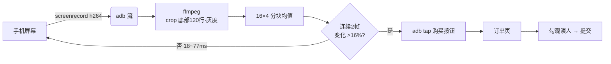

# 大麦抢票机器人 · 实战版


> 一套**不依赖 Appium 轮询**的大麦 App 抢票实现：
> `screenrecord` 视频流 → ffmpeg 解码 → 像素分块差分 → `adb` 注入点击。
>
> 本文档不仅写"怎么跑"，也写**为什么它这次没抢到**——完整复盘见 **[REPORT.md](REPORT.md)**。

---

## 📌 一图看懂



**为什么不用文字识别**：大麦 9.0.39 把**场次、票档、购买按钮的 `text` 节点全置空**了
（只有 `可预约`/`满1张打8.5折` 这类标签有文字）。所以任何"按价格/日期点选"的方案都不可行，
**像素变化是唯一可靠的信号**。

---

## 📊 实战成绩单

目标：昆明·薛之谦「万兽之王」**2026-12-31 21:00 / 看台 ¥517 / 2 张**
开抢：2026-11-22 17:17:00

| 环节 | 结果 | 数字 |
|---|:---:|---|
| 开售检测 | ✅ | **304 ms**（17:17:00.304，第 564 帧） |
| 注入点击 | ✅ | **273 ms 后**完成（17:17:00.577） |
| 订单页生成 | ✅ | 17:17:01.2，2 张 × ¥517 = **¥1034** |
| 观演人勾选 | ✅ | 张＊秋 / 王＊天 自动勾选 |
| 自动提交 | ❌ | 脚本误判"没进选票页"→ 停手 |
| 最终 | ❌ | 人工接管 53 秒后遇排队限流，未提交 |

> **工程上赢了 3 次，输在 1 个 `if` 判断上。** 详见 [REPORT.md](REPORT.md)。

---

## ⚡ 性能实测

| 指标 | 本项目 | 人手 | 接口级工具 |
|---|---:|---:|---:|
| 开售检测 | **18–154 ms** | 250 ms | — |
| 点击落地 | **125 ms** | 150 ms | — |
| **端到端** | **160–280 ms** | 350–500 ms | 50–150 ms |
| 轮询帧率 | 13–57 fps | — | — |
| 误报率 | **0 / 600 帧** | — | — |

> 结论：在"必须走真实界面"这条路里属于偏上水平，但比接口级慢一个数量级。

---

## 🚀 快速开始

```bash
# 1. 依赖
pip install -r requirements.txt          # 仅 appium 客户端；其余用标准库
# 另需：adb（Android platform-tools）、ffmpeg

# 2. 配置
cp bot-config.sample.json bot-config.json
#   改：场次日期 / 票档 / 张数 / 观演人姓名

# 3. 改常量（按你的分辨率实测）
#   grab_517.py: SERIAL / CTA_TAP / SUBMIT_TAP / CROP_Y

# 4. 开抢前自检（16 项）
python final_check.py

# 5. 到点自动执行
python grab_517.py run --stream --at 17:16:50
```

**只读演练**（不点任何东西，只看能不能检测到）：

```bash
python grab_517.py watch --stream --max 600
```

---

## 🧩 核心设计

### 1. 为什么用视频流，不用 Appium？

| 方案 | 问题 |
|---|---|
| `driver.page_source` 轮询 | UiAutomator2 的 instrumentation 进程在详情页**被系统反复杀掉**：`instrumentation process is not running` |
| `uiautomator dump` | 详情页有视频/倒计时，**永远拿不到 idle**：`could not get idle state` |
| `screencap` 整屏 | 每次搬 10 MB，**0.5–1.3 s/帧**，太慢 |
| **`screenrecord` + ffmpeg** | **13–57 fps，~18 ms/帧** ✅ |

### 2. 抗抖动的差分算法

不是"像素变了一点点就点"，而是：

1. 只取屏幕底部 **120 行**（购买栏），灰度化 → 每帧仅 129 KB
2. 压成 **16×4 分块均值**（抗闪烁、抗渐变）
3. 与基线比较，**≥16% 的分块变化**才算命中
4. **连续 2 帧**都命中才触发（防误报）

实测 600 帧静态画面：**最大变化 0.0%**。

### 3. 安全边界：绝不误触

- 只点**白名单**文案（`立即购买/立即抢购/立即预订`）；
- 「已取消预约」「返回重新选购」等破坏性按钮**不在任何路径上**；
- 空白观演人配置 → **拒绝提交**；
- 每步动作后校验 `activity`，没达到预期状态就停手并截图。

---

## 📁 文件结构

```
.
├── grab_517.py            主程序：视频流监听 → 点击 → 订单处理
├── hammer.py              订单页强推：识别「继续尝试」弹窗并连点
├── final_check.py         开抢前 16 项验收自检
├── bot-config.sample.json 参数模板（场次/票档/张数/观演人）
├── log-excerpt.txt        实战关键 10 秒原始日志（毫秒级）
├── requirements.txt
├── README.md
└── REPORT.md              完整复盘：时间线 / 根因 / 7 个 bug / 改进清单
```

---

## 🐛 期间修掉的 7 个致命 Bug

| # | Bug | 后果 |
|---|---|---|
| 1 | `warned` 变量未初始化 | **开抢 3 秒后必崩** |
| 2 | `adb shell "screencap \| tail"` 分配 PTY，二进制被换行污染（869625≠864000 字节） | 读到错位像素 |
| 3 | screencap 原始流末尾 4 字节 footer 未剥离 | 整图错位 1 px、RGB 串位 |
| 4 | 购买按钮坐标压边线（2310 vs 实际 2306–2366） | 可能点空 |
| 5 | 选票页"确定"坐标按宽按钮估算 | 预约弹层布局不同会点空 |
| 6 | 把"缺货"当售罄 | 详情页有别的城市"缺货"→ **开局就停手** |
| 7 | 观演人按全名匹配 | 列表页姓名脱敏成 `*永秋` → 找不到人 |

---

## 🎯 已知限制

- **单机单账号**：热门场次成功率天然受限；
- **验证码不会解**：出现滑块只能停手交人；
- **强依赖页面坐标**：大麦改版需重新标定；
- **不自动支付**：提交成功后由人工在 15 分钟内付款。

---

## ⚖️ 免责声明

本项目仅供**学习与研究**（Android 自动化、视频流像素分析、adb 注入）。
大麦用户协议禁止自动化抢票，使用可能导致账号风控或订单取消。**未用于任何转售行为**。
仓库内所有个人信息（姓名、证件号、手机号、设备序列号）均已脱敏。