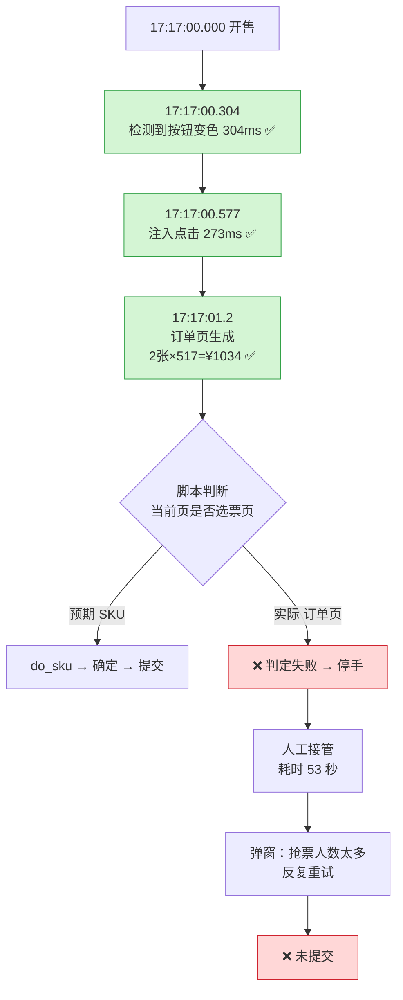
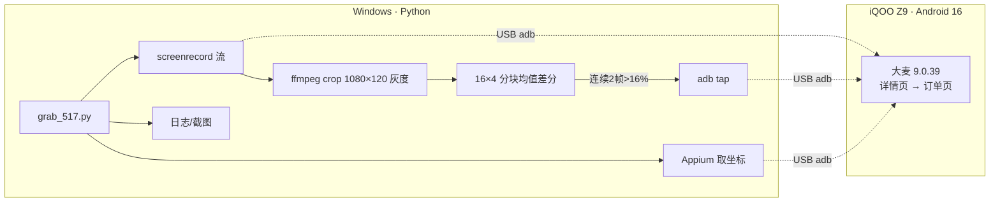

# 实战复盘：一次差 1 个 `if` 的抢票


> **目标**：昆明·薛之谦「万兽之王」· 2026-12-31 21:00 · 看台 **¥517** · **2 张**
> **开抢**：2026-11-22 17:17:00
> **结果**：检测成功、点击成功、订单页生成（2 张 ¥1034、观演人已勾），**提交失败**。

---

## 摘要：赢在哪、输在哪



**一句话**：前 99% 跑赢了，输在"预约直通订单页、不经过选票页"这个分支没写。

---

## 一、毫秒级时间线

| 时刻 | 事件 | 耗时 |
|---|---|---:|
| 17:02:26 | 预热启动，自检 7 项全 PASS | — |
| 17:16:32 | ⚠️ 发现前台被切到选票页（此前误操作） | — |
| 17:16:40 | 按返回键却退到了首页 | — |
| 17:16:46 | 从首页「抢票预约」卡片重回详情页 | **抢救 6 秒** |
| 17:16:50.28 | 视频流监听启动 | — |
| 17:16:51.64 | 基线建立（第 1 帧） | — |
| **17:17:00.304** | **检测到购买栏变化 25%**（第 564 帧） | **+304 ms** |
| **17:17:00.577** | **注入点击 (680, 2336)** | **+273 ms** |
| 17:17:01.23 | 进入 `DmOrderActivity` | +653 ms |
| 17:17:01.23 | ❌ 脚本判定"没进选票页"→ 停手 | — |
| 17:17:17 | 人工接管，确认订单页内容 | +16 s |
| 17:17:54 | 首次点击「立即提交」→ 弹「抢票人数太多」 | +53 s |
| 17:22:37 | 首次进入阿里安全校验容器 | — |
| 17:27:12 | 退回桌面，结束 | — |

> **最大损失**：订单页出现到首次提交之间空转 **53 秒**。

---

## 二、根因分析（按贡献度）

### 2.1 直接原因：状态机假设错误 —— 设计缺陷

脚本假设点击购买后**必然经过选票页**：

```python
def do_sku(bot, cfg, sid=None):
    act = activity()
    if "NcovSku" not in act and "Sku" not in act:
        log_fn("没进到选票页，停手", "FAIL")   # ← 订单页也被判成失败
        return False
```

但**预约已经把场次、票档、张数全部锁定**，大麦于是**跳过选票页、直接进订单页**。
脚本把"成功"读成了"失败"，主动停手。

**修复**（已合入仓库代码）：

```diff
-    if res in ("tapped", "sku"):
-        if not do_sku(log_fn, cfg, sid):
-            log_fn("选票页处理失败，请手动接管", "STOP")
+    act_now = activity()
+    if "DmOrder" in act_now:
+        log_fn("预约直通订单页，跳过选票处理", "OK")
+    elif res in ("tapped", "sku"):
+        if not do_sku(log_fn, cfg, sid):
+            log_fn("选票页处理失败，请手动接管", "STOP")
```

### 2.2 放大因素：人工接管 53 秒

停手后必须：截图 → 视觉识别 → 确认观演人/金额 → 才敢点提交。
在热门场次，这 53 秒就是"有票"与"没票"的分界线。

### 2.3 竞争因素：服务端限流

17:17:54 首次提交即弹「**抢票人数太多啦，继续尝试别放弃**」——
说明此刻已进入排队限流，需要反复重试才有概率挤进去。

### 2.4 风控因素：阿里安全校验

重试过程中多次跳转 `com.alibaba.wireless.security...ContainerActivity`（淘系人机校验容器），
会打断提交流程。

### 2.5 次要：数量逻辑（事后证明不需要）

预约已锁 **2 张**，脚本里"点加号"被主动关闭（避免买成 3 张）——这个决策是对的。

---

## 三、系统架构



### 为什么必须绕开 Appium 做主监听

| 方案 | 实测结果 |
|---|---|
| `driver.page_source` 轮询 | instrumentation 进程**被系统杀掉**：`instrumentation process is not running` |
| `uiautomator dump` | 详情页视频/倒计时导致**永不 idle**：`could not get idle state` |
| `screencap` 全屏 | 10 MB/帧，**0.5–1.3 s/帧** |
| **`screenrecord` + ffmpeg 裁切** | **13–57 fps，约 18 ms/帧** ✅ |

---

## 四、性能实测

| 环节 | 数值 | 说明 |
|---|---:|---|
| Appium 会话建立 | 4.1–6.6 s | 开抢前预热，不占抢票时间 |
| 视频流帧率 | 13–57 fps | 静态降帧、动效升帧（编码器自适应） |
| 检测延迟 | 18–154 ms | 1–2 帧 |
| adb 往返 | 74 ms | `exec-out` 实测中位 |
| 设备执行 | ~50 ms | 注入速度 |
| **端到端** | **160–280 ms** | 本次实战 273 ms |
| 误报 | **0 / 600 帧** | 静态基线最大变化 0.0% |

横向对比：

| 方案 | 端到端 |
|---|---:|
| 接口级/协议级工具 | 50–150 ms |
| **本项目（UI 自动化）** | **160–280 ms** |
| 人手 | 350–500 ms |
| 传统 Appium 轮询 | 500–2000 ms |

---

## 五、期间修掉的 7 个致命 Bug

| # | Bug | 现象 | 修法 |
|---|---|---|---|
| 1 | `warned` 未初始化 | 开抢 **3 秒后崩溃** | 初始化 `False` |
| 2 | `adb shell "screencap \| tail"` 走 PTY | 二进制被换行污染（**869625 ≠ 864000** 字节） | 改 `exec-out sh -c` |
| 3 | screencap 末尾 **4 字节 footer** | 整图错位 1 px、RGB 串位（按钮显示成彩色噪点） | 截取后丢弃末 4 字节 |
| 4 | CTA 坐标压边线（2310 vs 2306–2366） | 可能点空 | 截图实测校正为 (680,2336) |
| 5 | 选票页「确定」按宽按钮估算 | 预约弹层布局不同 → 点空 | 三坐标兜底 + 每步校验页面 |
| 6 | 把"缺货"列入售罄关键词 | 详情页有别的城市"缺货" → **开局停手** | 从关键词表移除 |
| 7 | 观演人按全名匹配 | 列表页脱敏成 `*永秋` | 全名→后两字→后一字 三级匹配 |

---

## 六、如果重来：改进清单

- [x] **状态机双分支**（已修）：SKU 与订单页都要能接
- [ ] **提交链路脱离 Appium**：订单页「立即提交」纯坐标兜底，不因找不到元素停手
- [ ] **弹窗纳入主循环**：识别「继续尝试」自动连点直到离开订单页（`hammer.py` 已实现，应内置）
- [ ] **失败即重试**：订单页已生成这种高价值状态，优先重试而非停手
- [ ] **验证码响铃**：出现滑块时用声音/震动提醒人工
- [ ] **多机多账号**：单机单号在热门场次成功率天然受限
- [ ] **更短路径**：从「我的-抢票预约」直接点「抢」，少一次页面跳转

---

## 七、附录：原始日志（节选）

```text
[17:16:50.282] OK    到达 17:16:50，开始监听
[17:16:50.372] OK    视频流已启动（crop y=2280 h=120）
[17:16:51.641] OK    基线已建立（第 1 帧）
[17:16:52.947] INFO  第 120 帧：无变化（3s, 45fps）
[17:16:54.937] INFO  第 240 帧：无变化（5s, 52fps）
[17:16:56.926] INFO  第 360 帧：无变化（7s, 54fps）
[17:16:58.920] INFO  第 480 帧：无变化（9s, 56fps）
[17:17:00.304] HIT   第 564 帧检测到变化 25%（10.02s）
[17:17:00.577] OK    已点击购买按钮 (680, 2336)
[17:17:01.227] INFO  当前 activity=cn.damai/.ultron.view.activity.DmOrderActivity
[17:17:01.227] FAIL  没进到选票页，停手
[17:17:01.730] STOP  选票页处理失败，请手动接管
```

---

## 八、合规说明

- 仅用于个人观演，**未用于任何转售**；
- 大麦用户协议禁止自动化抢票，使用可能导致账号风控或订单取消；
- 文中所有个人信息（姓名、证件号、手机号、设备序列号）均已脱敏。